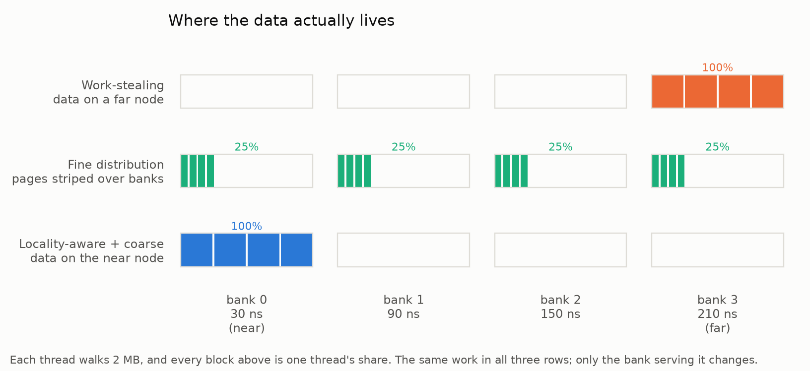
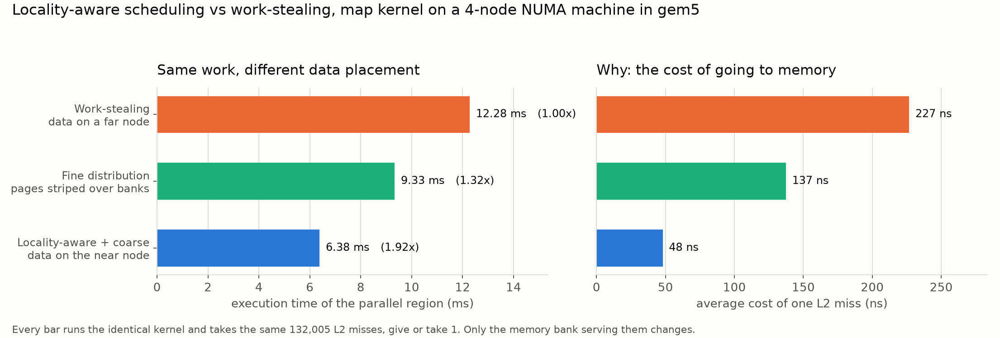
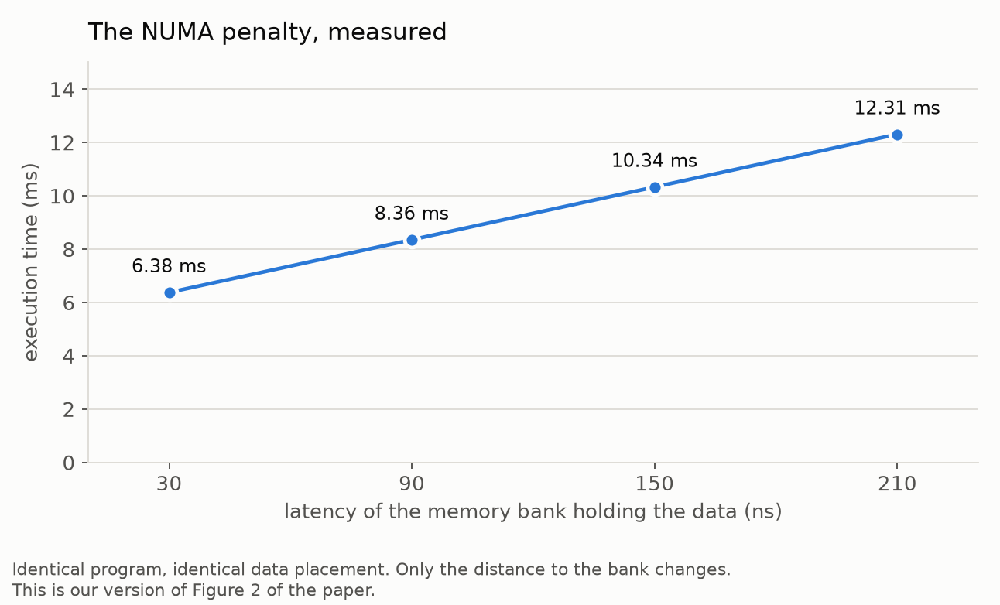

# Simulating "Locality-Aware Task Scheduling and Data Distribution" in gem5

Course project. Paper being reproduced:

> A. Muddukrishna, P. A. Jonsson, M. Brorsson, *Locality-Aware Task Scheduling and Data Distribution for OpenMP Programs on NUMA Systems and Manycore Processors*, Scientific Programming, 2015.

Everything here runs on [gem5](https://www.gem5.org/), a cycle-level computer architecture simulator.


## 1. What the paper is actually saying

A NUMA machine splits its memory into nodes. Each node sits next to a group of cores.

- A core reading memory on **its own node** is fast.

- A core reading memory on **another node** is slow, because the request has to cross the interconnect between sockets.

The paper measures this on a real four-socket, eight-node, 48-core AMD Opteron 6172 machine. Their Figure 2 is the key number:

| accessing 4 MB from node 0 | latency |
| - | - |
| node 0 (its own memory) | about 40 cycles |
| nodes 1 to 7 (remote) | 240 to 340 cycles |


So a remote access costs **6 to 8 times** more than a local one.

Now here is the problem. OpenMP task schedulers use **work-stealing**: an idle core grabs a task from any queue it can reach. That is great for keeping every core busy, and it is completely blind to where the task's data lives. So a core on node 0 can end up running a task whose data sits on node 7, and then it spends most of its time waiting.

The paper fixes both halves of this:

1. **Data distribution.** Let the programmer say how an allocation should be spread, with three simple choices and nothing else to learn:

   - `standard` - leave it to the OS (this is first-touch)

   - `fine` - spread the allocation page by page, round robin, over every node

   - `coarse` - put each whole allocation on one node, round robin per allocation

2. **Locality-aware scheduling.** When a task is created, look at its `depend` list to work out which pages it will touch, then put it on the queue of the node that holds those pages. Only bother when the task's working set is bigger than the last level cache, because below that it does not matter.

Result in the paper: up to **69%** faster on scientific benchmarks, and never slower, so it is safe as a default.


## 2. What we reproduce, and what we do not

Being straight about scope is better than overclaiming, so say this in the presentation.

**We do not** run their exact setup. That needs a 48-core Opteron, a full Linux with `libnuma`, and MIR, their own task runtime. None of that fits in a simulator in a sensible amount of time.

**We do** build a NUMA machine inside gem5 with the same shape and the same near-to-far latency ratio, run the paper's own `map` kernel on it, and measure what each data placement policy costs. A simulator is actually better than real hardware for this, because:

- the latencies are exact numbers we chose, not noisy measurements

- nothing else is running on the machine, so there is zero interference

- we can count every cycle and every memory access, which you cannot do with a stopwatch

So: we reproduce the **mechanism and the conclusion**, not their exact percentages.

**One honest limitation.** gem5's classic memory system gives each memory controller a single latency value. So what we model is distance measured from one node, which is exactly what the paper's Figure 2 measures. We are not modelling a full node-to-node distance matrix. If sir asks, that is the answer, and the cause and effect we demonstrate are unchanged.


## 3. The machine we build in gem5

`configs/numa_system.py` builds this:

```
      core 0        core 1        core 2        core 3
        |             |             |             |
      L1I/L1D       L1I/L1D       L1I/L1D       L1I/L1D
      32kB each     32kB each     32kB each     32kB each
        |             |             |             |
       L2            L2            L2            L2
      256kB         256kB         256kB         256kB
        \____________ \___________/____________/
                   system crossbar
         |            |            |           |
      bank 0       bank 1       bank 2      bank 3
      32 MB        32 MB        32 MB       32 MB
      30 ns        90 ns       150 ns      210 ns
      (near)                                (far)
```

- 4 x86 cores at 2 GHz, in-order timing model (`X86TimingSimpleCPU`)

- private L1I, L1D and L2 per core

- four memory banks, each a separate `SimpleMemory` controller covering its own 32 MB slice of the physical address space, each with its own access latency

The bank latencies are scaled from the paper's Figure 2: near is cheap, far is roughly seven times worse.


## 4. The benchmark

`benchmarks/map_numa.c` is the paper's `map` kernel from their Listing 1. Their version:

```
for (int i = 0; i < N; i++) {
    list[i] = malloc(sizeof(int) * SZ);
    initialize(i, list[i], SZ);
}
for (int i = 0; i < N; i++) {
    #pragma omp task input(list[i][0:SZ-1])
    map(list[i], SZ);
}
#pragma omp taskwait
```

Ours is the same thing with pthreads instead of OpenMP tasks, because gem5's syscall-emulation mode handles raw pthreads much more reliably than it handles `libgomp`. One thread per core, each thread scaling its own vector, no sharing between threads. That is the same structure and the same memory behaviour.

**The important property:** every policy runs the *identical* loop, the same instruction count and the same number of cache lines. The only thing that changes is the **address** of those cache lines, which decides which bank serves them. So any difference in the results is memory locality and nothing else.

The three policies, mapped onto the paper:

| our flag | paper's situation |
| - | - |
| `remote` | work-stealing balanced the load, the data was left on a far node |
| `interleaved` | the paper's `fine` distribution, pages striped over all banks |
| `local` | the paper's proposal, locality-aware scheduling plus `coarse` distribution |

This is the whole experiment in one picture. Every thread walks its own 2 MB, and the blocks show which bank serves it: `remote` leaves all of it on the far bank, `interleaved` gives every bank a quarter of it, and `local` puts all of it on the near bank. Same data, same instructions and the same number of trips to memory in every row — only the distance each request travels changes.




### How we control where data physically lands

This is the clever bit and it is worth explaining.

gem5's syscall-emulation mode hands out physical pages **in the order the program first touches them**. So the benchmark:

1. `mmap`s one big region covering nearly all of physical memory,

2. touches it one page at a time, in increasing address order.

After that pass, an offset inside that region maps predictably onto a physical address, and therefore onto a bank. Picking a bank is now just picking an offset.

Nice detail for the presentation: that first-touch pass **is** the paper's baseline `first-touch malloc` policy. We are literally running their baseline to set up the experiment.

We do not just assume it worked. The results table reports the percentage of memory accesses that landed on each bank, which proves the placement.


## 5. What we measure, and how it maps to the paper

All of it comes straight out of gem5's `stats.txt`.

| our metric | gem5 stat | the paper's equivalent |
| - | - | - |
| execution time | `simSeconds` | execution time, Figures 3, 7, 9 |
| CPI | region cycles × cores / committed instructions (region from `simTicks`) | dispatch stall cycles |
| L2 miss latency | `l2cache.overallMissLatency / overallMisses` | Figures 2 and 5 |
| accesses per bank | `mem_ctrls<i>.numReads/numWrites` | proof of data distribution |
| the kernel's checksum | printed into each run's `console.log` | proof every run did the identical work |


On CPI: every run executes the same instructions, so if CPI goes up it is because the core is sitting there doing nothing, waiting for memory. That is exactly what the paper calls dispatch stall cycles.

One trap worth knowing about, because it is easy to get wrong. CPI is taken from the simulated length of the parallel region, not from the sum of the per-core `numCycles` counters. On this gem5 version those counters are not cleared by `m5_reset_stats` for cores that have not started yet, so cpu1 to cpu3 also carry the first-touch pass that runs *before* the region, and summing them inflates CPI by a constant +2.0. `analyze.py` measures the region from `simTicks` instead and warns if a core ever reports more cycles than the region lasted.


## 6. The two experiments

**Experiment A, the policy comparison.** Run the same kernel under `remote`, `interleaved` and `local`, and compare. This is the paper's Figure 7 in miniature.

**Experiment B, the NUMA distance sweep.** Keep the data in bank 0 every single time, and only change how far bank 0 is: 30, 90, 150, 210 ns. Nothing else in the program moves, so whatever changes is pure NUMA cost. This redraws the paper's Figure 2 from our own simulation.

The 30 ns row is the same invocation as the `local` policy run above, so it doubles as a determinism check: identical inputs, bit-identical simulated statistics, different host timings.


## 7. How to run it

You need gem5 built for X86 (`build/X86/gem5.opt`).

```
# build the benchmark. It must be static (gem5 SE mode prefers it) and it
# must be built WITH the gem5 instrumentation: without -DGEM5 there is no
# dump of the parallel region, and analyze.py silently measures the whole
# program instead, first-touch pass and all.
GEM5_SRC=${GEM5_SRC:-$HOME/gem5}
cd benchmarks
gcc -O2 -static -pthread -I"$GEM5_SRC/include" -DGEM5 \
    -o map_numa map_numa.c \
    "$GEM5_SRC/util/m5/build/x86/out/libm5.a"
cd ..
# the libm5 path depends on how gem5 was built, so check it first with
#   find "$GEM5_SRC" -name 'libm5.a'

# all seven simulation runs
GEM5=/path/to/gem5/build/X86/gem5.opt ./run_experiments.sh

# every run must have two stats blocks (one from m5_dump_stats for the
# parallel region, one at exit); a 1 means the binary was not instrumented
grep -c "Begin Simulation Statistics" results/*/stats.txt

# turn the stats into the results table
python3 analyze.py
```

A single run on its own:

```
gem5.opt --outdir=results/try configs/numa_system.py \
    --binary ./benchmarks/map_numa \
    --options "local 4 4 32 2048 1" \
    --cores 4 --banks 4 --bank-size 32MB \
    --latencies "30ns,90ns,150ns,210ns"
```

Benchmark arguments are `<policy> <threads> <banks> <bank_MB> <slice_KB> <repeats>`.


## 8. Results

Machine: 4 cores at 2 GHz, 32 kB L1s, 256 kB L2 per core, four 32 MB banks at 30 / 90 / 150 / 210 ns. Benchmark: 4 threads, 2 MB of working set each — eight times the 256 kB L2 — walked once (`repeats` is 1), so the whole walk is compulsory misses that really do go to memory.

Full tables in `results/summary.txt`. The three charts below are drawn by `make_charts.py` straight from `results/summary.json`.

### Experiment A, the three policies

| policy | time | CPI | speedup |
| - | - | - | - |
| Work-stealing, data on a far node (baseline) | 12.28 ms | 7.79 | 1.00x |
| Fine distribution, pages striped over banks | 9.33 ms | 5.92 | 1.32x |
| Locality-aware + coarse, data on the near node | 6.38 ms | 4.05 | **1.92x** |



The left panel is the headline: identical work, 12.28 ms when the data lives on a far bank against 6.38 ms when it lives on the near one. The right panel is the reason — one trip to memory costs 227 ns on the far bank against 48 ns on the near one, while the number of trips is the same in every bar to within a single miss.


**Locality-aware scheduling made the kernel 1.92 times faster.** The paper reports up to 69% on real hardware, we get 92%, which is expected: our simulated machine has no OS noise and no other processes competing, so the locality effect shows up undiluted.

Where the traffic actually landed, which proves the placement worked:

| policy | bank 0 | bank 1 | bank 2 | bank 3 |
| - | - | - | - | - |
| far node | 0.3% | 0.0% | 0.0% | 99.7% |
| fine / striped | 25.2% | 24.8% | 24.8% | 25.1% |
| near node | 99.7% | 0.0% | 0.0% | 0.3% |


And the reason for the whole difference, the cost of one L2 miss:

| policy | avg L2 miss | L2 misses |
| - | - | - |
| far node | 227 ns | 132,005 |
| fine / striped | 137 ns | 132,004 |
| near node | 48 ns | 132,004 |


**The miss count is identical to within one miss across all three runs.** That is the single most convincing number in the whole project. The cores did exactly the same work and took exactly the same number of trips to memory. The only thing that changed is how long each trip took. Nothing else can explain the 1.92x.

Note that fine distribution lands exactly in the middle at 137 ns, because a quarter of its accesses go to each bank and the mean of 30, 90, 150 and 210 is 120. That matches the paper's point that fine is a safe, mediocre default: better than getting it wrong, worse than getting it right.

### Experiment B, the NUMA distance sweep

| bank latency | time | CPI | slowdown |
| - | - | - | - |
| 30 ns | 6.38 ms | 4.05 | 1.00x |
| 90 ns | 8.36 ms | 5.30 | 1.31x |
| 150 ns | 10.34 ms | 6.56 | 1.62x |
| 210 ns | 12.32 ms | 7.81 | 1.93x |



Four points, one line: the same program with the same data placement, varying only how far away the bank holding the data is. Execution time tracks that distance straight up, from 6.38 ms at 30 ns to 12.32 ms at 210 ns, which isolates the NUMA penalty with nothing else in the picture.


Perfectly linear. Same program, same placement, only the distance changes, and execution time tracks it straight up. This is the paper's Figure 2 redrawn from our own simulation.

### Independent replay check

Both experiments were re-run from scratch on a different gem5 build (v24.1.0.1, compiled from source) to check that the numbers above are not an artefact of one particular setup. Every execution time and every CPI value in the tables above reproduced exactly, the per-bank traffic split was unchanged, and the L2 miss counts moved by at most one miss.

All seven runs also print the same kernel checksum, 8192. That is the direct proof that every policy did identical work, and it is why the comparison is fair: the runs differ only in how long each trip to memory took, never in how much work was done or how many trips were made.

The `console.log` sitting beside each run's `stats.txt` is from that replay, while the `stats.txt` files and the single `config.ini` are from the original runs. The checksum is the same either way, because it depends only on the work the kernel does and not on how long its memory took.
